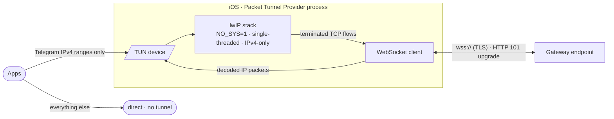
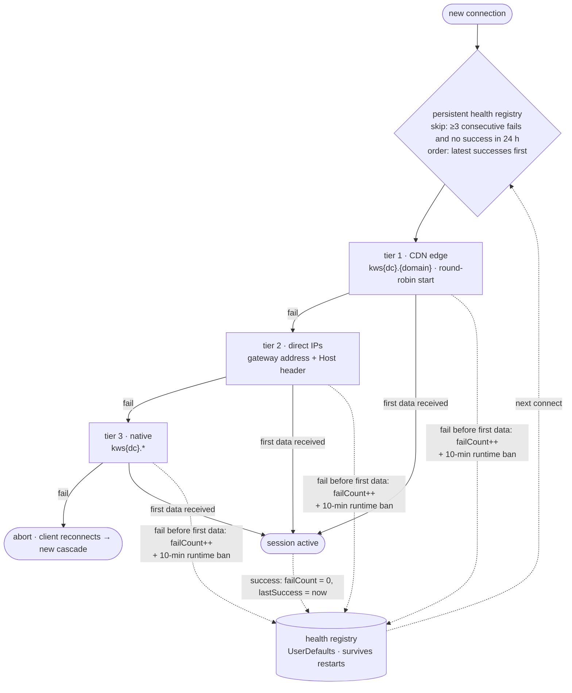

# WSBridge

IP-over-WebSocket relay for iOS (Packet Tunnel Provider), scoped to
Telegram. Russian version: [README.ru.md](README.ru.md)

## What it does

The app creates a virtual network interface (TUN) and carries Telegram's
IPv4 TCP traffic through it as a WebSocket stream. Everything else keeps
using the device's normal connection:



1. The system routes only the Telegram IPv4 ranges into the TUN device;
   all other destinations leave the device directly.
2. An in-process lwIP stack (single-threaded, `NO_SYS=1`, IPv4-only)
   terminates TCP and re-emits each flow as a WebSocket frame stream.
3. Frames are carried over TLS (`wss://`) to an HTTP endpoint that
   upgrades to WebSocket (status 101) and relays the stream.
4. Responses are decoded back to IP packets and written to TUN.

## Scope

This is a split tunnel, not a device-wide VPN. What it does and does not
carry:

| Traffic | Carried |
| --- | --- |
| Telegram IPv4, TCP | yes — through the relay |
| Telegram IPv4, other protocols (UDP, ICMP) | no — dropped |
| IPv6 | no — no IPv6 route is announced |
| Every other destination | no — bypasses the tunnel |

The routed ranges are `149.154.0.0/16`, `91.108.0.0/16` and
`91.105.192.0/24` ([`Tunnel/TelegramDCs.swift`](Tunnel/TelegramDCs.swift)).
Full ranges are used rather than the known DC addresses alone, because
Telegram may connect to any address inside them.

Encrypted DNS (see below) is supplied in the tunnel configuration; how
widely iOS applies it depends on the system's split-tunnel routing, not
on this app.

## Endpoint selection

Connections are established through an ordered cascade:



- **CDN edge** — `kws{dc}.{domain}` hostnames, resolved and rotated
  round-robin; prefix of live endpoints is preferred.
- **Direct IPs** — gateway addresses used directly with `Host` header.
- **Native** — `kws{dc}.` endpoints as final fallback.

A per-endpoint health registry persists across restarts: consecutive
failures, last failure and last success timestamps. Endpoints with
≥3 consecutive failures and no success within 24 h are excluded until
recovery; most recent successes are tried first.

## Endpoint list updates

The endpoint list is hot-updatable without rebuilding the app:

1. The app fetches the list from the origin URL, falling back to two
   CDN mirrors (10 s timeout, cache bypass).
2. Each entry is validated by format and DNS resolution; a list with
   fewer than 3 resolving entries is discarded as stale.
3. Validated entries are merged into the persistent registry —
   the built-in list always stays first as an immutable fallback;
   known-live entries are never re-tested, dead entries get a
   DNS re-check, entries dead for 7 days and absent from the upstream
   list are evicted.
4. The registry feeds the cascade on next tunnel start.
   Auto-refresh is rate-limited to once per 30 minutes and runs
   after tunnel start, not before it.

## DNS

Encrypted transport is selectable in-app: DNS-over-TLS (default) or
DNS-over-HTTPS. If the selected server lacks the chosen transport, the
other one is used; plain UDP otherwise. DoT connects to the server IP
directly with SNI and needs no hostname bootstrap, which DoH under a
tunnel cannot always rely on. Presets ship with resolver lists and links
to the provider's site; custom configs require a DoT hostname. Changes
take effect on next tunnel start.

## Build

- Xcode project is generated via `xcodegen` from `project.yml`.
- CI (GitHub Actions) builds an unsigned `.ipa` on every push to `main`.

```sh
brew install xcodegen
xcodegen generate
xcodebuild -project WSBridge.xcodeproj -scheme WSBridge -sdk iphoneos build
```

### Versioning

The version is `V.V.N` — **version.patch.build**, and the third number is
the build number. Two values in `project.yml` produce it:

- `WSB_VERSION` — the version block (`0.3`), bumped on release milestones;
- `WSB_BUILD` — the build number inside that block, starting from zero:
  `0.3.0`, `0.3.1`, `0.3.2`, … and reset to `0` on the next block
  (`0.4.0`).

The composed string `<WSB_VERSION>.<WSB_BUILD>` is used everywhere — the
UI, `CFBundleShortVersionString`, the GBox manifest and the release tag.
There is no separate build number shown in parentheses. CI fails the
build if the plists disagree with these values, and the release workflow
refuses a tag that differs from the composed version:

```sh
# bump WSB_BUILD (or WSB_VERSION + WSB_BUILD=0 for a new block), then
git push origin main
git tag v0.3.1 && git push origin v0.3.1
```

## License

MIT © 2026 l1ratch. Portable logic adapted from
[Flowseal/tg-ws-proxy](https://github.com/Flowseal/tg-ws-proxy) (MIT).
