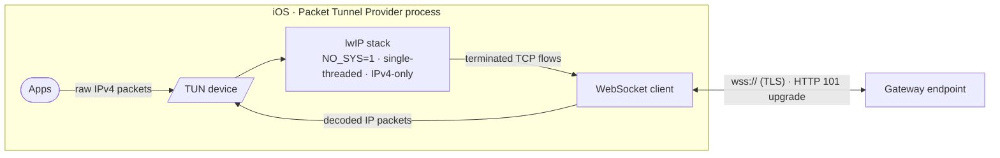
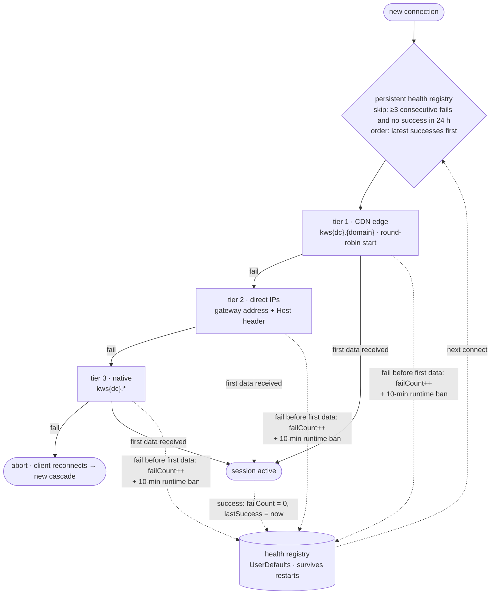

# WSBridge

IP-over-WebSocket relay for iOS (Packet Tunnel Provider). Russian version: [README.ru.md](README.ru.md)

## What it does

The app creates a virtual network interface (TUN) and forwards all IPv4
traffic through it as a WebSocket stream:



1. System routes all IPv4 traffic into the TUN device.
2. An in-process lwIP stack (single-threaded, `NO_SYS=1`, IPv4-only)
   terminates TCP and re-emits each flow as a WebSocket frame stream.
3. Frames are carried over TLS (`wss://`) to an HTTP endpoint that
   upgrades to WebSocket (status 101) and relays the stream.
4. Responses are decoded back to IP packets and written to TUN.

## Endpoint selection

Connections are established through an ordered cascade:



- **CDN edge** — `kws{dc}.{domain}` hostnames, resolved and rotated
  round-robin; prefix of live endpoints is preferred.
- **Direct IPs** — gateway addresses used directly with `Host` header.
- **Native** — `kws{dc}.` endpoints as final fallback.

A per-endpoint health registry persists across restarts: consecutive
failures, last failure and last success timestamps. Endpoints with
≥3 consecutive failures and no success within 24 h are excluded until
recovery; most recent successes are tried first.

## Endpoint list updates

The endpoint list is hot-updatable without rebuilding the app:

1. The app fetches the list from the origin URL, falling back to two
   CDN mirrors (10 s timeout, cache bypass).
2. Each entry is validated by format and DNS resolution; a list with
   fewer than 3 resolving entries is discarded as stale.
3. Validated entries are merged into the persistent registry —
   the built-in list always stays first as an immutable fallback;
   known-live entries are never re-tested, dead entries get a
   DNS re-check, entries dead for 7 days and absent from the upstream
   list are evicted.
4. The registry feeds the cascade on next tunnel start.
   Auto-refresh is rate-limited to once per 30 minutes and runs
   after tunnel start, not before it.

## DNS

Resolver priority chain: DNS-over-HTTPS → DNS-over-TLS → plain UDP.
Presets and custom servers are configurable in-app; changes take
effect on next tunnel start.

## Build

- Xcode project is generated via `xcodegen` from `project.yml`.
- CI (GitHub Actions) builds an unsigned `.ipa` on every push to `main`.

```sh
brew install xcodegen
xcodegen generate
xcodebuild -project WSBridge.xcodeproj -scheme WSBridge -sdk iphoneos build
```

## License

MIT © 2026 l1ratch. Portable logic adapted from
[Flowseal/tg-ws-proxy](https://github.com/Flowseal/tg-ws-proxy) (MIT).
