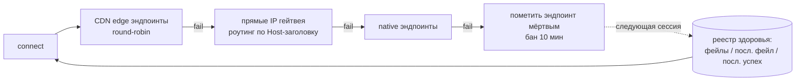

# WSBridge (RU)

IP-over-WebSocket релей для iOS (Packet Tunnel Provider).
English version: [README.md](README.md)

## Что делает

Приложение создаёт виртуальный сетевой интерфейс (TUN) и переносит весь
IPv4-трафик через него в виде WebSocket-потока:

```
┌─────────────┐  raw IP-пакеты  ┌──────────────┐  TCP/WS-кадры  ┌─────────────┐
│  TUN-интерф.│ ───────────────▶│  стек lwIP    │ ─────────────▶ │  WebSocket- │
│  (система)  │ ◀───────────────│  (NO_SYS=1)   │ ◀─────────────│   клиент    │
└─────────────┘  ре-инъекция    └──────────────┘                └──────┬──────┘
                                                                        │ wss://
                                                                        ▼
                                                              ┌─────────────────┐
                                                              │ HTTP 101 gateway │
                                                              └─────────────────┘
```

1. Система направляет весь IPv4-трафик в TUN-интерфейс.
2. Встроенный стек lwIP (однопоточный, `NO_SYS=1`, только IPv4)
   терминирует TCP и переизлучает каждый поток кадрами WebSocket.
3. Кадры передаются по TLS (`wss://`) HTTP-эндпоинту, который
   апгрейдит соединение (статус 101) и ретранслирует поток.
4. Ответы декодируются обратно в IP-пакеты и пишутся в TUN.

## Выбор эндпоинтов

Соединения устанавливаются через упорядоченный каскад:



- **CDN edge** — хосты `kws{dc}.{domain}`, резолвятся и ротируются
  round-robin; префикс живых эндпоинтов приоритетен.
- **Прямые IP** — адреса гейтвея напрямую с заголовком `Host`.
- **Native** — `kws{dc}.`-эндпоинты как последний fallback.

Реестр здоровья эндпоинтов переживает перезапуски: число подряд идущих
фейлов, время последнего фейла и последнего успеха. Эндпоинты с
≥3 фейлами подряд и без успеха за 24 ч исключаются до восстановления;
свежие успехи пробуются первыми.

## Обновление списка эндпоинтов

Список эндпоинтов обновляется без пересборки приложения:

1. Приложение скачивает список с основного URL, с фолбэком на два
   CDN-зеркала (таймаут 10 с, обход кэша).
2. Каждая запись валидируется форматом и DNS-резолвом; список, где
   резолвится меньше 3 записей, отбрасывается как протухший.
3. Валидные записи мерджатся в персистентный реестр — встроенный
   список всегда первым, как неизменяемый fallback; известные живые
   не перетестируются, мёртвые получают DNS-ре-чек, мёртвые >7 дней
   и пропавшие из апстрима удаляются.
4. Реестр питает каскад при следующем старте туннеля.
   Автообновление — не чаще раза в 30 минут, после старта туннеля,
   не до него.

## DNS

Цепочка приоритета: DNS-over-HTTPS → DNS-over-TLS → обычный UDP.
Пресеты и свои серверы настраиваются в приложении; изменения
применяются при следующем старте туннеля.

## Сборка

- Xcode-проект генерируется через `xcodegen` из `project.yml`.
- CI (GitHub Actions) собирает unsigned `.ipa` при пуше в `main`.

```sh
brew install xcodegen
xcodegen generate
xcodebuild -project WSBridge.xcodeproj -scheme WSBridge -sdk iphoneos build
```

## Лицензия

MIT © 2026 l1ratch. Портируемая логика —
[Flowseal/tg-ws-proxy](https://github.com/Flowseal/tg-ws-proxy) (MIT).
