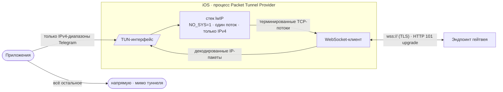

# WSBridge (RU)

IP-over-WebSocket релей для iOS (Packet Tunnel Provider), работающий
в пределах Telegram. English version: [README.md](README.md)

## Что делает

Приложение создаёт виртуальный сетевой интерфейс (TUN) и переносит
IPv4 TCP-трафик Telegram через него в виде WebSocket-потока. Всё
остальное продолжает ходить обычным путём устройства:



1. Система направляет в TUN-интерфейс только IPv4-диапазоны Telegram;
   остальные назначения уходят с устройства напрямую.
2. Встроенный стек lwIP (однопоточный, `NO_SYS=1`, только IPv4)
   терминирует TCP и переизлучает каждый поток кадрами WebSocket.
3. Кадры передаются по TLS (`wss://`) HTTP-эндпоинту, который
   апгрейдит соединение (статус 101) и ретранслирует поток.
4. Ответы декодируются обратно в IP-пакеты и пишутся в TUN.

## Область действия

Это split-туннель, а не VPN на всё устройство. Что проходит через него,
а что нет:

| Трафик | Проходит |
| --- | --- |
| Telegram IPv4, TCP | да — через релей |
| Telegram IPv4, прочие протоколы (UDP, ICMP) | нет — отбрасываются |
| IPv6 | нет — IPv6-маршрут не анонсируется |
| Все остальные назначения | нет — идут мимо туннеля |

Маршрутизируемые диапазоны — `149.154.0.0/16`, `91.108.0.0/16` и
`91.105.192.0/24` ([`Tunnel/TelegramDCs.swift`](Tunnel/TelegramDCs.swift)).
Берутся полные диапазоны, а не только известные адреса DC: Telegram может
подключаться к любому адресу внутри них.

Шифрованный DNS (см. ниже) передаётся в конфигурации туннеля; насколько
широко iOS его применяет, зависит от системной маршрутизации
split-туннеля, а не от этого приложения.

## Выбор эндпоинтов

Соединения устанавливаются через упорядоченный каскад:


- **CDN edge** — хосты `kws{dc}.{domain}`, резолвятся и ротируются
  round-robin; префикс живых эндпоинтов приоритетен.
- **Прямые IP** — адреса гейтвея напрямую с заголовком `Host`.
- **Native** — `kws{dc}.`-эндпоинты как последний fallback.

Реестр здоровья эндпоинтов переживает перезапуски: число подряд идущих
фейлов, время последнего фейла и последнего успеха. Эндпоинты с
≥3 фейлами подряд и без успеха за 24 ч исключаются до восстановления;
свежие успехи пробуются первыми.

## Обновление списка эндпоинтов

Список эндпоинтов обновляется без пересборки приложения:

1. Приложение скачивает список с основного URL, с фолбэком на два
   CDN-зеркала (таймаут 10 с, обход кэша).
2. Каждая запись валидируется форматом и DNS-резолвом; список, где
   резолвится меньше 3 записей, отбрасывается как протухший.
3. Валидные записи мерджатся в персистентный реестр — встроенный
   список всегда первым, как неизменяемый fallback; известные живые
   не перетестируются, мёртвые получают DNS-ре-чек, мёртвые >7 дней
   и пропавшие из апстрима удаляются.
4. Реестр питает каскад при следующем старте туннеля.
   Автообновление — не чаще раза в 30 минут, после старта туннеля,
   не до него.

## DNS

Шифрованный транспорт выбирается в приложении: DNS-over-TLS (по
умолчанию) или DNS-over-HTTPS. Если у выбранного сервера нет нужного
транспорта — используется второй, иначе обычный UDP. DoT идёт напрямую
к IP сервера с SNI и не требует бутстрап-резолва имени, на который DoH
под туннелем не всегда может положиться. Пресеты идут со списками
резолверов и ссылками на сайт провайдера; своим конфигам DoT-хост
обязателен. Изменения применяются при следующем старте туннеля.

## Сборка

- Xcode-проект генерируется через `xcodegen` из `project.yml`.
- CI (GitHub Actions) собирает unsigned `.ipa` при пуше в `main`.

```sh
brew install xcodegen
xcodegen generate
xcodebuild -project WSBridge.xcodeproj -scheme WSBridge -sdk iphoneos build
```

### Версионирование

Версия — `V.V.N`, то есть **версия.патч.сборка**, где третье число и есть
номер сборки. Её дают два значения в `project.yml`:

- `WSB_VERSION` — блок версии (`0.3`), растёт на релизных вехах;
- `WSB_BUILD` — номер сборки внутри блока, с нуля: `0.3.0`, `0.3.1`,
  `0.3.2`, … и сбрасывается в `0` на новом блоке (`0.4.0`).

Склеенная строка `<WSB_VERSION>.<WSB_BUILD>` используется везде — в UI,
в `CFBundleShortVersionString`, в манифесте GBox и в теге релиза.
Отдельного номера сборки в скобках нигде нет. CI падает, если plist-ы
разошлись с этими значениями, а релизный workflow отказывается собирать
тег, не совпадающий со склеенной версией:

```sh
# подними WSB_BUILD (или WSB_VERSION + WSB_BUILD=0 для нового блока), затем
git push origin main
git tag v0.3.1 && git push origin v0.3.1
```

## Лицензия

MIT © 2026 l1ratch. Портируемая логика —
[Flowseal/tg-ws-proxy](https://github.com/Flowseal/tg-ws-proxy) (MIT).
