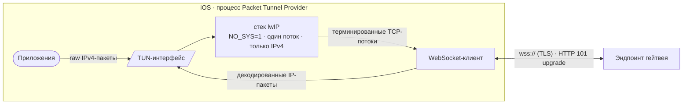
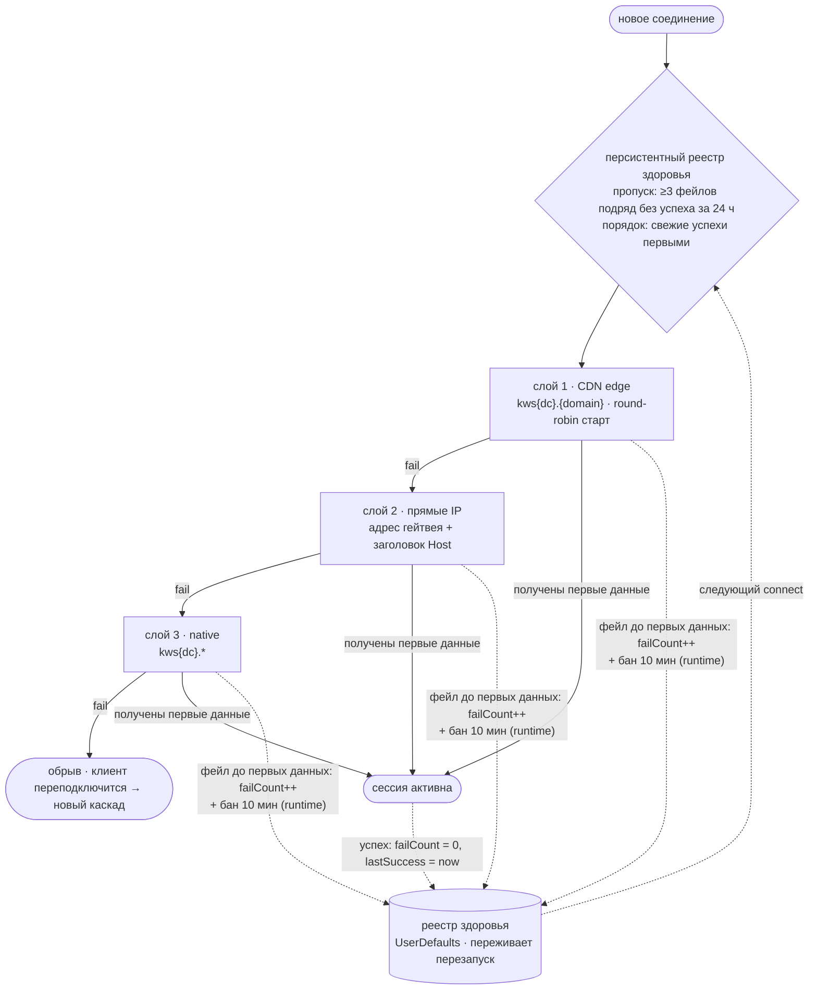

# WSBridge (RU)

IP-over-WebSocket релей для iOS (Packet Tunnel Provider).
English version: [README.md](README.md)

## Что делает

Приложение создаёт виртуальный сетевой интерфейс (TUN) и переносит весь
IPv4-трафик через него в виде WebSocket-потока:



1. Система направляет весь IPv4-трафик в TUN-интерфейс.
2. Встроенный стек lwIP (однопоточный, `NO_SYS=1`, только IPv4)
   терминирует TCP и переизлучает каждый поток кадрами WebSocket.
3. Кадры передаются по TLS (`wss://`) HTTP-эндпоинту, который
   апгрейдит соединение (статус 101) и ретранслирует поток.
4. Ответы декодируются обратно в IP-пакеты и пишутся в TUN.

## Выбор эндпоинтов

Соединения устанавливаются через упорядоченный каскад:



- **CDN edge** — хосты `kws{dc}.{domain}`, резолвятся и ротируются
  round-robin; префикс живых эндпоинтов приоритетен.
- **Прямые IP** — адреса гейтвея напрямую с заголовком `Host`.
- **Native** — `kws{dc}.`-эндпоинты как последний fallback.

Реестр здоровья эндпоинтов переживает перезапуски: число подряд идущих
фейлов, время последнего фейла и последнего успеха. Эндпоинты с
≥3 фейлами подряд и без успеха за 24 ч исключаются до восстановления;
свежие успехи пробуются первыми.

## Обновление списка эндпоинтов

Список эндпоинтов обновляется без пересборки приложения:

1. Приложение скачивает список с основного URL, с фолбэком на два
   CDN-зеркала (таймаут 10 с, обход кэша).
2. Каждая запись валидируется форматом и DNS-резолвом; список, где
   резолвится меньше 3 записей, отбрасывается как протухший.
3. Валидные записи мерджатся в персистентный реестр — встроенный
   список всегда первым, как неизменяемый fallback; известные живые
   не перетестируются, мёртвые получают DNS-ре-чек, мёртвые >7 дней
   и пропавшие из апстрима удаляются.
4. Реестр питает каскад при следующем старте туннеля.
   Автообновление — не чаще раза в 30 минут, после старта туннеля,
   не до него.

## DNS

Шифрованный транспорт выбирается в приложении: DNS-over-TLS (по
умолчанию) или DNS-over-HTTPS. Если у выбранного сервера нет нужного
транспорта — используется второй, иначе обычный UDP. DoT идёт напрямую
к IP сервера с SNI и не требует бутстрап-резолва имени, на который DoH
под туннелем не всегда может положиться. Пресеты идут со списками
резолверов и ссылками на сайт провайдера; своим конфигам DoT-хост
обязателен. Изменения применяются при следующем старте туннеля.

## Сборка

- Xcode-проект генерируется через `xcodegen` из `project.yml`.
- CI (GitHub Actions) собирает unsigned `.ipa` при пуше в `main`.

```sh
brew install xcodegen
xcodegen generate
xcodebuild -project WSBridge.xcodeproj -scheme WSBridge -sdk iphoneos build
```

### Версионирование

Всем управляет одно значение — `WSB_BUILD` в `project.yml`. И приложение,
и расширение получают `CFBundleVersion = N` и
`CFBundleShortVersionString = 0.2.N`, то есть последнее число версии и
есть номер сборки. CI берёт это же значение для GBox-манифеста и падает,
если plist-ы с ним разошлись; релизный workflow отказывается собирать тег,
не совпадающий с `WSB_BUILD`. Выпуск — одна правка плюс тег:

```sh
# подними WSB_BUILD, затем
git push origin main
git tag v0.2.88 && git push origin v0.2.88
```

## Лицензия

MIT © 2026 l1ratch. Портируемая логика —
[Flowseal/tg-ws-proxy](https://github.com/Flowseal/tg-ws-proxy) (MIT).
